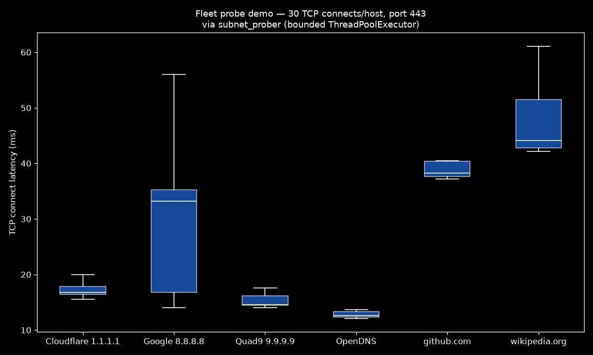

# telco-network-automation


## Objective

Synthetic, testable tooling for network operations: bounded connectivity probes and configuration-drift reporting. The examples are independent reconstructions for public demonstration; they do not represent Telefónica, a vendor, or a production network.

## Demo



*Live run of [`examples/dns_probe_demo.py`](examples/dns_probe_demo.py): 30 TCP connects per host through `subnet_prober` - p50 ranges from 12.6 ms (OpenDNS) to 44.1 ms (Wikipedia).*

## Architecture

```text
┌───────────────────┐    ┌──────────────────────┐    ┌───────────────┐
│  device fleet     │───▶│  src/ (probers, IaC) │───▶│  CSV reports  │
│  RAN / core nodes │    │  bounded thread pool │    │  latency p50  │
└───────────────────┘    └──────────────────────┘    └───────────────┘
```

- **`src/`** — stdlib-only, dependency-light automation modules that run on any jump host or CI runner.
- Every network interaction is bounded by explicit timeouts and a capped worker pool to protect production networks.

## Tech Stack

| Layer | Technology |
|---|---|
| Language | Python 3.10+ (stdlib only) |
| Concurrency | `concurrent.futures` (bounded `ThreadPoolExecutor`) |
| Networking | `socket`, `ipaddress` |
| Reporting | CSV export, latency percentile summaries |
| CI | GitHub Actions (ruff lint + smoke test) |

## Repository Layout

```text
telco-network-automation/
├── src/
│   ├── __init__.py
│   ├── subnet_prober.py      # parallel TCP reachability prober with latency stats
│   ├── config_drift.py       # config drift detection vs golden baseline (difflib)
│   ├── atp_runner.py         # deterministic acceptance checks against fixtures
│   └── synthetic_labs.py     # deployment, resilience, stress and alarm labs
├── tests/
│   ├── test_config_drift.py  # unit tests with fixed config samples
│   ├── test_atp_runner.py    # local ATP checks and failure modes
│   └── test_synthetic_labs.py # deterministic lab scenarios and failure modes
├── examples/
│   ├── mop_template.md       # generic carrier-grade Method of Procedure template
│   ├── atp_template.md       # generic Acceptance Test Procedure template
│   ├── ran_config_sample.cfg # synthetic multi-technology MML config (invented data)
│   ├── baseline.cfg          # golden baseline sample
│   └── running.cfg           # drifted running-config sample
├── docs/
│   └── confidentiality.md    # masking & confidentiality policy
├── pyproject.toml            # ruff lint config
├── .pre-commit-config.yaml
└── .github/workflows/ci.yml
```

## Execution

```bash
python -m src.subnet_prober --cidr 192.168.1.0/24 --port 22 --workers 128
# probed=254 reachable=12 p50_latency_ms=1.84 output=probe_results.csv
```

Useful for fleet health checks before configuration rollouts:

```bash
# gate a deployment on fleet reachability
python -m src.subnet_prober --cidr 10.20.0.0/22 --port 830 --output netconf_gate.csv
```

### Config drift detection

Diff a running config against its golden baseline. Added and removed lines matching security-sensitive patterns (`password`, `snmp`, `tacacs`, `ssh-key`, ...) are classified as `critical`; other changes are classified as `warning`. The tool writes CSV and can optionally write structured JSON:

```bash
python -m src.config_drift --running examples/running.cfg --baseline examples/baseline.cfg --json-output drift_report.json
# drift=... added=... removed=... sensitive=... output=drift_report.csv
```

The tool only detects and reports drift. It does not connect to devices or apply configuration changes.

### Synthetic ATP runner

Run local acceptance checks against a deliberately fictional environment fixture:

```bash
python -m src.atp_runner \
  --spec examples/atp_spec.json \
  --fixture examples/atp_fixture.json \
  --output atp_report.json
# checks=3 failed=0 status=PASS
```

The runner supports configuration-presence, service-state and connectivity checks.
Checks can include a bounded synthetic duration to exercise timeout handling. A failed
acceptance check returns exit code `1`; malformed input returns `2`. No network connection
is made and no device is modified.

### Synthetic operational labs

The lab runner executes five deterministic scenarios from a JSON fixture:

```bash
python -m src.synthetic_labs \
  --fixtures examples/synthetic_lab_fixtures.json \
  --output labs_report.json
# labs=5 failed=0 status=PASS
```

The scenarios cover deployment prechecks, rollback restoration, simulated
active/standby failover, bounded load/error-rate stress and alarm correlation.
They do not open sockets, generate traffic or interact with infrastructure.

### Engineering handbook

The engineering methodology lives in the companion repository — **[telco-engineering-handbook](https://github.com/maezgonz/telco-engineering-handbook)**: public-standard references plus a procedure map for ATP, resilience, stress testing, upgrades, integrations, troubleshooting, baselines, expansions and reconfigurations.

The templates here operationalize that knowledge; the handbook documents it.

### Carrier-grade templates and samples

The examples are generic and synthetic:

- **[examples/mop_template.md](examples/mop_template.md)** — generic Method of Procedure: preconditions, timed steps, validation KPIs and rollback plan
- **[examples/atp_template.md](examples/atp_template.md)** — generic Acceptance Test Procedure: hardware + functional test tables and acceptance criteria
- **[examples/ran_config_sample.cfg](examples/ran_config_sample.cfg)** — synthetic multi-technology site configuration (GSM/UMTS/LTE, MML-style)

All values are invented placeholders; see the [confidentiality policy](docs/confidentiality.md).

## Results

Sample drift run (examples/ vs golden baseline):

| Metric | Value |
|---|---:|
| Drift findings | 9 |
| Lines added / removed | 6 / 3 |
| Security-sensitive findings | 2 (SNMP community + HTTP server) |

## Roadmap

- [x] Configuration drift detection against golden baselines
- [ ] NETCONF/RESTCONF configuration push with dry-run validation
- [ ] Device inventory collection from controller REST APIs
- [x] Synthetic ATP checks with JSON report and CI gate
- [x] Synthetic alarm correlation with fixtures
- [ ] Alarm correlation for RAN KPI degradation

## License

[MIT](LICENSE) — Matias Gonzalez
